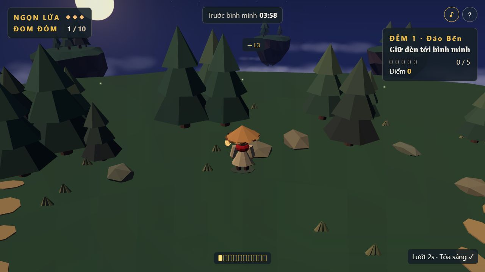

# Đảo Đèn Lồng

**[Xem video demo](docs/demo/demo.mp4)** · **[Tải bản chơi v1.0.0](https://github.com/baonvt/K5-L3A-DAY12-NguyenVoThaiBao-2A202603638-AI-SDLC-Dao-Den-Long/releases/tag/v1.0.0)**

Nguyễn Võ Thái Bảo · 2A202603638 · L3A

Mây giữ đèn trên ba hòn đảo. Nhặt đom đóm để thắp đèn, châm dầu trước khi Bóng Mực kéo tới và giữ đủ ánh sáng tới bình minh. Mỗi đêm có bản đồ, địa hình và thời gian riêng.



## Cài và chơi

Cần Node.js 20 trở lên, npm và trình duyệt có WebGL 2. Trên macOS, Linux hoặc Windows với PowerShell 7, chạy ba dòng sau. Máy chủ in địa chỉ và mở trình duyệt nếu terminal hỗ trợ. Địa chỉ mặc định là [127.0.0.1:4173](http://127.0.0.1:4173).

```sh
git clone https://github.com/baonvt/K5-L3A-DAY12-NguyenVoThaiBao-2A202603638-AI-SDLC-Dao-Den-Long.git dao-den-long
cd dao-den-long
npm ci && npm start
```

Bản ZIP đính kèm Release đã chứa engine. Giải nén, chạy `node tools/serve.js` trong thư mục vừa giải nén để chơi ngoại tuyến.

## Điều khiển và luật chơi

| Thao tác | Phím mặc định |
|---|---|
| Di chuyển | WASD hoặc phím mũi tên |
| Xoay camera | Kéo trên cảnh hoặc Z / X |
| Nhảy, lướt | Space, Shift trái |
| Nạp đèn hoặc châm dầu | E |
| Tỏa sáng | F |
| Tạm dừng và tiếp tục | Esc hoặc P |

Mở **?** từ menu hoặc **Cài đặt** lúc tạm dừng để đổi phím, chỉnh âm lượng, độ nhạy, bảng màu, chữ lớn và giảm chuyển động. Trên thiết bị cảm ứng có các nút ngay trên màn hình.

| Đêm | Địa hình | Thời gian | Đèn cần sáng khi bình minh |
|---|---|---:|---:|
| Đảo Bến | Đảo tròn, năm lối đá | 240 giây | 3/5 |
| Cầu Tre | Hai đảo, cầu hẹp và bục nhảy | 270 giây | 4/6 |
| Tháp Chuông | Ba tầng, hai dốc, gió mạnh | 300 giây | 5/7 |

Thắp đèn lần đầu cần 10 đom đóm, thắp lại cần 5. Đèn vừa thắp có 100 dầu và tự hao 1 dầu/giây. Mỗi đom đóm châm thêm 10 dầu. Dưới 30 dầu, Bóng Mực có thể hút thêm 5 dầu/giây mỗi con. Sức chứa tăng từ 10 đến 20 theo số lần thắp. Mây thua ngay khi mất hết ba Ngọn Lửa.

Mỗi đom đóm nạp cộng 5 điểm. Thắp lần đầu cộng 100, thắp lại cộng 40. Tỏa sáng cộng 5 điểm mỗi bóng, hoặc 15 nếu bóng đang hút dầu. Khi thắng, mỗi đèn sáng thưởng 50 cộng phần nguyên lượng dầu và mỗi Ngọn Lửa thưởng 50. Bảng xếp hạng chỉ cộng điểm các đêm thắng.

## Bảng xếp hạng

Cuối lượt thua hoặc khi thắng Đêm 3, nhập tên 3–12 ký tự gồm chữ Latin, số hoặc dấu gạch dưới. Mở **Bảng xếp hạng** từ menu để xem top 10. Khi chơi bằng lệnh chính thức, dữ liệu ở `~/.dao-den-long/scores.json`. Biến `DAO_DATA_DIR` cho phép dùng thư mục riêng. Xuất lại dữ liệu kể cả sau khi đóng game:

```sh
node tools/serve.js --export-leaderboard out.json
```

Nếu tự đưa thư mục web lên dịch vụ tĩnh, bảng điểm của phiên bản tĩnh lưu trong trình duyệt. Lệnh xuất phía trên đọc bảng điểm của bản chạy bằng máy chủ Node cục bộ.

## Test, headless, benchmark và soak

```sh
npm test
npm run proof
node tools/headless.js --seed 17 --night 1 --ticks 21600 --scenario docs/proof/phase-3/scenario.json --inputs docs/proof/phase-3/inputs.json --snapshot-every 1 --out trace.jsonl
node tools/bench.js --seed 42 --duration 30 --out bench.json
node tools/soak.js --seed 7 --nights 10 --out soak.json
```

Headless xử lý một đêm tại 60 tick/giây mô phỏng và ghi JSONL. Benchmark cần màn hình đồ họa thật và Chrome/Chromium/Edge. Nếu chưa có, chạy `npx playwright-core install chromium`, hoặc đặt `CHROME_PATH` tới trình duyệt tương thích. Trên Linux cần phiên desktop và các thư viện hệ thống của Chromium. Cửa sổ đồ họa dùng vùng vẽ 1280×720, khởi động 3 giây, đo thời gian giữa các khung hình bằng requestAnimationFrame. WebGL qua trình duyệt không có API tắt vsync hay lấy RSS toàn bộ tiến trình GPU, nên báo `vsync_off: false`, `peak_mem_mb: null`. Soak dùng RSS của chính tiến trình Node.

[Contract v1.3](game.contract.json) · [Số đo benchmark](bench.json) · [Số đo soak](soak.json) · [Cấu hình máy và ghi chú đo](docs/phase-4.md)

## Bằng chứng theo phase

| Tag | Luật tại tag | Bằng chứng |
|---|---|---|
| `phase-1` | Đảo Bến và Contract v1.0 | [Tiêu chí và kết quả](docs/phase-1.md), [JSONL đầu tiên](docs/proof/seed17/actual.jsonl) |
| `phase-2` | Ba đêm và số liệu chuẩn | [Tiêu chí](docs/phase-2.md), [JSONL và ảnh](docs/proof/phase-2) |
| `phase-3` | Dầu và thắng lúc bình minh | [Quyết định thiết kế](docs/phase-3.md), [scenario, input và kết quả](docs/proof/phase-3) |
| `phase-4` | Xếp hạng, tiếp cận và phát hành | [Ảnh và kiểm tra giao diện](docs/proof/phase-4), [retro](docs/retro.md) |

## Sáng tạo của tôi

Đường đá nối tâm đảo với đèn, chiếc đèn nhỏ treo trên nón lá và tiếng chuông cao dần khi túi đầy giúp người chơi định hướng. Mô phỏng headless dùng chung luật với bản chơi. [Ảnh toàn cảnh](docs/proof/phase-4/menu.jpg) · [Nhật ký thay đổi](CHANGELOG.md) · [Nguồn và công cụ](CREDITS.md) · [Giấy phép](LICENSE)
